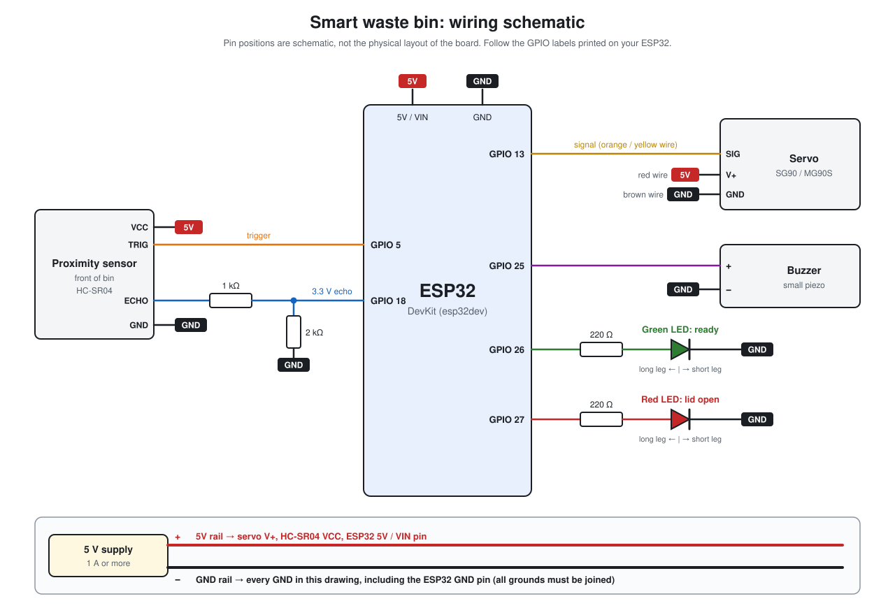
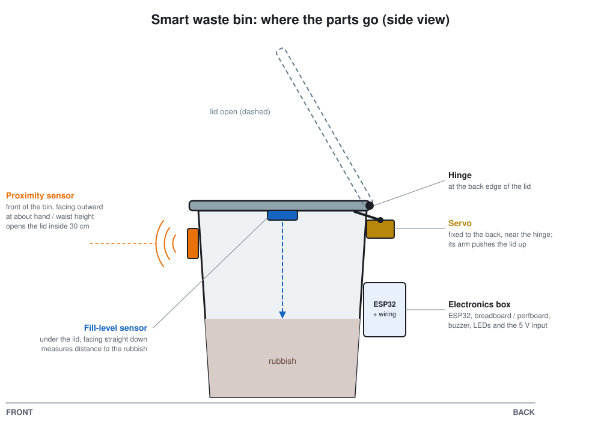

# Smart Waste Bin (ESP32)

A waste bin that opens its lid when someone comes close, beeps to greet them, and shows its status on two LEDs.

Built with an ESP32, PlatformIO and the Arduino framework.

## What it does

| Situation | Lid | Green LED | Red LED | Buzzer |
|---|---|---|---|---|
| Waiting, nobody near | Closed | On | Off | Silent |
| Someone within 30 cm | Opens | Off | On | Short beep |
| Person leaves | Closes after 3 s | On again | Off | Silent |

## Parts list

| Qty | Part | Notes |
|---|---|---|
| 1 | ESP32 DevKit board | The common 30-pin or 38-pin "ESP32 DevKit V1" / WROOM-32 |
| 1 | HC-SR04 ultrasonic sensor | Detects someone approaching |
| 1 | Servo motor | SG90 for a light lid, MG90S or MG996R for a heavier one |
| 1 | Piezo buzzer | Small 3.3 V–5 V type, active or passive |
| 1 | Green LED and 1 red LED | Standard 5 mm |
| 2 | 220 Ω resistor | One per LED |
| 1 | 1 kΩ resistor | Echo voltage divider |
| 1 | 2 kΩ resistor | Echo voltage divider (two 1 kΩ in series also work) |
| 1 | 5 V power supply, 1 A or more | A phone charger with a cut USB cable, or a 5 V adapter (2 A for an MG996R) |
| 1 | Breadboard and jumper wires | Perfboard later for the permanent build |
| 1 | Micro-USB / USB-C data cable | For uploading the firmware |
| 1 | Bin with a hinged lid | Plus glue, tape, or screws, and a stiff wire or stick for the servo linkage |

## Wiring



### Connection table

| Part | Part pin | Goes to |
|---|---|---|
| Proximity HC-SR04 | VCC | 5V rail |
| | TRIG | GPIO 5 |
| | ECHO | GPIO 18 **through the voltage divider** |
| | GND | GND rail |
| Servo | Signal (orange / yellow) | GPIO 13 |
| | V+ (red) | 5V rail |
| | GND (brown / black) | GND rail |
| Buzzer | + | GPIO 25 |
| | − | GND rail |
| Green LED | Long leg (anode) | GPIO 26 through 220 Ω |
| | Short leg (cathode) | GND rail |
| Red LED | Long leg (anode) | GPIO 27 through 220 Ω |
| | Short leg (cathode) | GND rail |
| ESP32 | 5V / VIN | 5V rail |
| | GND | GND rail |

### The echo voltage divider (do not skip this)

The HC-SR04 sends its echo signal at 5 V, but ESP32 pins are only rated for 3.3 V. Two resistors bring it down:

```
HC-SR04 ECHO ──[ 1 kΩ ]──┬── ESP32 GPIO
                         │
                      [ 2 kΩ ]
                         │
                        GND
```

5 V × 2 kΩ ÷ (1 kΩ + 2 kΩ) = 3.3 V.

### Power

- Run a **5V rail** and a **GND rail** along the breadboard's side strips, fed by the 5 V supply.
- The servo, the sensor and the ESP32's 5V / VIN pin all take power from the 5V rail.
- **Every ground must be joined together**, including the ESP32's GND pin. A missing common ground is the most common reason a servo twitches or a sensor reads nonsense.
- Do not power the servo from the ESP32's 3V3 pin. It cannot supply enough current and the board will reset.
- For early bench tests you can run everything from the USB cable alone with a small SG90, but if the ESP32 restarts when the servo moves, switch to the external supply.
- Most DevKit boards have a protection diode, so the USB cable can stay plugged in while the external supply feeds VIN. If you are unsure about your board, unplug the supply's + wire from VIN while USB is connected.

## Where the parts go



## Step-by-step build

### Step 1: Install the software

1. Install [Visual Studio Code](https://code.visualstudio.com/).
2. In VS Code, open Extensions, search for **PlatformIO IDE** and install it. Restart VS Code when asked.
3. Download this project:

```bash
git clone https://github.com/12-miles/smart_waste_Bin.git
```

4. In VS Code choose **File → Open Folder** and pick the `smart_waste_Bin` folder. PlatformIO downloads the ESP32 tools the first time, which takes a few minutes.

### Step 2: Check the board on its own

1. Plug the ESP32 into your computer with nothing else attached.
2. Click the **→ (Upload)** arrow in the blue bar at the bottom of VS Code, or run:

```bash
pio run -t upload
```

3. If the upload stalls at `Connecting.....`, hold the **BOOT** button on the board until it starts writing.
4. Click the **plug icon (Serial Monitor)**, or run:

```bash
pio device monitor
```

You should see `Smart bin ready`. If you do, the board and cable are fine. Unplug it before wiring.

### Step 3: Wire the ultrasonic sensor

1. Push the ESP32 into the breadboard.
2. Connect the 5V and GND rails as described under [Power](#power).
3. Wire the HC-SR04: VCC to 5V, GND to GND, TRIG to GPIO 5.
4. Build the voltage divider and connect ECHO through it to GPIO 18.
5. Plug in, open the Serial Monitor, and wave a hand in front of the sensor. You should see `Lid opening`, `Lid open`, then `Lid closing` and `Lid closed` about 3 seconds after you move away.

### Step 4: Add the LEDs and buzzer

1. Green LED: long leg to a 220 Ω resistor, resistor to GPIO 26, short leg to GND.
2. Red LED: the same, on GPIO 27.
3. Buzzer: + to GPIO 25, − to GND.
4. Test: green is on while idle; a hand near the sensor gives a beep and switches to red.

### Step 5: Add the servo

1. Signal wire to GPIO 13, red to the 5V rail, brown / black to GND.
2. Leave the servo arm free (not attached to the lid yet).
3. Test: the arm should swing 90° when you approach and return when you leave.

### Step 6: Mount everything on the bin

1. **Proximity sensor:** on the front, facing outward, where a person's hand or body will be. Keep it clear of the lid's edge so the lid does not trigger it.
2. **Servo:** on the back of the bin near the hinge. Connect its arm to the lid with a stiff wire or stick so that turning the arm pushes the lid up.
3. **Electronics:** in a small box on the back, away from the rubbish.
4. Attach the servo arm with the lid **closed** and the bin powered on, so the closed position matches 0°.

### Step 7: Calibrate for your bin

All settings are in [`include/config.h`](include/config.h). Change a value, then upload again.

| Setting | What it means | How to set it |
|---|---|---|
| `OPEN_DISTANCE_CM` | How close someone must be | Raise it if you have to reach too far in; lower it if passers-by trigger it |
| `HOLD_OPEN_MS` | How long the lid stays open after you leave | 3000 = 3 seconds |
| `SERVO_CLOSED_DEG` / `SERVO_OPEN_DEG` | Lid positions | Adjust until the lid fully closes and opens without straining the servo. Swap the two values if it moves the wrong way |
| `SERVO_STEP_MS` | Lid speed | Higher is slower and gentler |


## Troubleshooting

| Problem | Likely cause and fix |
|---|---|
| Upload stuck at `Connecting.....` | Hold the BOOT button during upload. Try another USB cable; many are charge-only |
| ESP32 restarts when the servo moves | Servo is drawing too much from USB. Use the external 5 V supply |
| Lid never opens, distance always missing | TRIG and ECHO swapped, missing divider connection, or sensor not getting 5 V |
| Lid opens on its own | Sensor sees the lid, a wall or the floor. Re-aim it or lower `OPEN_DISTANCE_CM` |
| Servo jitters or buzzes | Grounds not joined, weak supply, or the lid is pushing against its limit; adjust the angles |
| Lid moves the wrong way | Swap `SERVO_CLOSED_DEG` and `SERVO_OPEN_DEG`, or flip the servo |
| No sound | Buzzer reversed; swap its legs |

## Project layout

```
platformio.ini             Board, framework and library settings
include/config.h           Pins and behaviour settings
src/main.cpp               The firmware
docs/                      Wiring and mounting diagrams
```

## Ideas for later

- Fill-level sensing with a second ultrasonic sensor under the lid, and a phone alert when the bin is full
- Manual button to hold the lid open while changing the bag
- Small OLED screen showing status messages
- Daily usage counter
- Web dashboard served by the ESP32
- Battery power with deep sleep
- Night mode that mutes the buzzer and dims the LEDs
